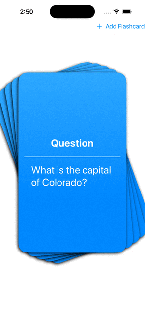

# lab4-ebaig2024 Flashcard Lab

## How the Project Was Created

- **Project Setup & Flashcard UI** — I started by creating a new SwiftUI project in Xcode. I designed the initial interface to resemble a flashcard by adding a title, question-and-answer text, and a card-style background.

- **Refactoring the Flashcard UI into a Custom View** — I refactored the original flashcard interface into a reusable custom SwiftUI view. This allowed the same component to display different questions and answers while supporting multiple flashcards.

- **Creating a Flashcard Deck** — After creating the reusable flashcard view, I updated `ContentView` to display multiple flashcards and arranged them to visually resemble a real deck of cards.

- **Adding Swipe Gestures** — I added swipe gestures that allow users to swipe cards left or right depending on whether they have memorized a card or need more practice. I also added visual cues to make the purpose of each swipe direction clear to the user.

- **Removing Swiped Cards from the Deck** — I implemented functionality that removes a card from the active deck after it is swiped. This allows users to work through the deck and focus their study sessions on cards that still need additional practice.

- **Resetting the Deck** — To make repeated study sessions possible, I added options for resetting the flashcard deck. Users can restore all of their cards or focus specifically on cards that need more practice. I used SwiftUI state properties in `ContentView` to manage the deck and connected the reset actions to buttons in the interface.

- **Presenting a Modal Sheet for Creating Flashcards** — I added a modal sheet that allows users to create their own flashcards. The sheet provides text fields where users can enter a custom question and answer before adding the new card to their deck.

- **Creating the Add Flashcard View** — Finally, I created a separate SwiftUI view for adding new flashcards. This view collects the user's question and answer and passes the newly created card back to the main card array, allowing it to immediately become part of the flashcard deck.

## Features

- [x] View a flashcard and toggle between the card's question and answer text
- [x] Understand the effects of swiping left or right by updating the cards color as the user swipes
- [x] Swipe left and right to progress though the deck
- [x] Reset the deck with all the cards or only cards they've categorized as needing more practice
- [x] Create new flashcards and add them to the deck

## Gif

